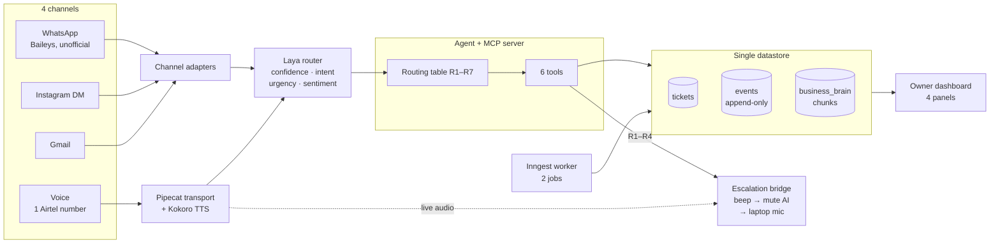

# Team 41 — AI Agent for Automated Customer Support and Ticket Triage

**Track:** Artificial Intelligence & Data Science · **Event:** SPHINX '26, 24-Hour Flagship Hackathon (MNIT Jaipur)

## Problem statement 2.5 — verbatim

> **2.5 AI Agent for Automated Customer Support and Ticket Triage**
> **Problem:** Small businesses drown in repetitive support queries and miss urgent ones, while hiring support staff is expensive.
> **Target users:** Startups, e-commerce stores, SaaS teams.
> **Approach:** Agent that reads incoming emails or chats, classifies intent and urgency, drafts replies from a company knowledge base, and escalates sensitive cases to a human. Stack: LLM with tool calling, RAG over FAQs, a simple ticket dashboard.
> **Bonus twist:** Sentiment tracking and an automatic weekly insights report on recurring complaints.

## One-line pitch

**One agent runs WhatsApp, Instagram, Gmail and a single phone line — and when it is not sure, it does not guess: it beeps a human onto the same live call.**

---

**Live link:** `TBD` — deployed at gate G3 (target 01:30 IST, Oct 31). If this still says TBD at 11:00, deployment is the only thing that matters.

**Hero screenshot:** `TBD` → `docs/img/hero.png` — Panel 1 (Live Queue) beside Panel 3 (Escalation Bay mid-takeover). Captured at Phase 3/4.

---

## The problem

A small team answers the same twelve questions all day across four inboxes, and the one message that actually needed a human in minutes sits unread for six hours. Hiring a support seat to absorb the repetitive volume costs more than the shop's software bill; not hiring costs the customer who never comes back.

**The cost of leaving it unsolved:** repetitive volume eats the workday, and urgency is invisible until it is a refund.

## The insight

Every support tool sorts by **channel**. Almost nothing sorts by **how sure the machine is**. Uncertainty is the signal a small business actually cares about — a confident answer can wait, a coin-flip answer cannot.

So the escalation trigger is not "the customer is angry" and not "the topic is billing". It is **`confidence_score < 50`**, plus three cheap hard rules (explicit request, distress, high urgency). Below 50, the agent never answers. It beeps.

And because a beep that reaches voicemail is worthless, escalation happens **on the same call**: the AI's voice is muted, the owner's laptop mic is bridged into the still-open line. The customer never hears a transfer, never gets a callback, never re-explains.

## What it does

| | |
|---|---|
| **Reads** 4 channels | WhatsApp, Instagram, Gmail, and one Airtel voice line — one queue, not four inboxes |
| **Classifies** in one contract | `confidence_score`, `intent`, `urgency`, `sentiment` — four fields, nothing else |
| **Decides** with 7 ordered rules | R1 explicit request · R2 confidence < 50 · R3 distress · R4 urgency ≥ 80 · R5 draft-only · R6 auto-reply · R7 fail safe |
| **Answers** from your own words | RAG over `business_brain.md`, seeded by a 12-question wizard — not a generic model's memory |
| **Escalates** without hanging up | `beep.wav` → mute AI → bridge laptop mic/speaker onto the live leg |
| **Shows its work** | Every decision writes an append-only event with its rule id and reason code |

## Architecture



Full diagram, state machines and the routing table: [`docs/ARCHITECTURE.md`](docs/ARCHITECTURE.md).

## Stack

| Layer | Choice | Note |
|---|---|---|
| Language / runtime | TypeScript on Node 26 | One language, one repo, one deploy target |
| Tests | `node --test` + native TS stripping | Zero test dependencies — survives hostile venue Wi-Fi |
| Voice | **Pipecat** transport, **Laya** router, **Kokoro** TTS | Runs locally; no cloud voice vendor in the path |
| WhatsApp | **Baileys** | ⚠ Unofficial WhatsApp Web client — see disclosure below |
| Agent surface | MCP server, exactly 6 tools | The agent has no other action surface |
| Async | **Inngest**, exactly 2 jobs | Nothing blocks the voice server |
| Datastore | Single store, engine `TBD` | `[AQ-23]` — chunks live inside it, not in a second system |

## How to run

```bash
npm install          # typescript only; the test suite needs nothing
npm test             # 68 tests, native runner
npm run typecheck    # tsc --noEmit, strict + erasableSyntaxOnly
npm run test:coverage
```

Full stack (dashboard, 6 tools, voice line): `TBD` — arrives at gate G3. Until then the repo runs the domain core only.

## What is real vs what is mocked

**This table is the single source of truth and is rewritten at every gate.** A row may say `REAL` only if a test or a screenshot is behind it. Last verified: **2026-10-30 18:45 IST**.

| Capability | Status | What is behind it |
|---|---|---|
| Routing table R1–R7, both state machines, tool envelope | **REAL** | 68 tests, 100% branch coverage, mutation-checked |
| 6 MCP tools | **NOT BUILT** | Contract frozen in `CAPABILITY.md`; slice S3 |
| Voice pipeline (Hinglish, Pipecat + Laya + Kokoro) | **NOT BUILT** | Phase 4; gated on the PSTN test (Q1) |
| Beep → mute → laptop bridge | **NOT BUILT** | Phase 4 — the one thing we never cut |
| WhatsApp / Instagram / Gmail intake | **NOT BUILT** | Phases 3 and 5 |
| Owner dashboard, 4 panels | **NOT BUILT** | Phases 2–3 |
| 12-question wizard → `business_brain.md` | **NOT BUILT** | Phase 2 |
| Inngest worker, 2 jobs | **NOT BUILT** | Phase 6 |
| Customer records, order history | **MOCKED (by design)** | Hand-seeded demo data. Real deployments import from the business's own system |
| Knowledge base content | **MOCKED (by design)** | A seeded doc set, authored by us. The retrieval is real; the corpus is sample data |
| Checkout link | **MOCKED (by design)** | The URL is real text the agent sends. No payment integration, no order mutation — F-non-goal "no money movement" |
| WhatsApp transport | **RISK DECLARED** | Baileys is an unofficial WhatsApp Web client. It can be rate-limited or banned mid-event. Isolated behind its own adapter so a ban degrades one channel, not the agent |

**Not claimed anywhere in this repo:** a trained model of our own, payment processing, outbound calling, a second phone number, customer logins, or an LLM in the critical path of an escalation.

## Team

**Team 41** — 2 people.

- Divyanshu Saini
- Pulkit Khowal

Evidence for Team ID 41: roster row 41 (2 members, APJ Abdul Kalam Hall) and seating block `41,2` (2 seats), cross-checked at check-in.

Two people, ~20 hours of buildable time. That is the scoping argument, not a sympathy line: one feature end-to-end beats eleven half-features — so the counts are frozen at 4 channels, 6 tools, 4 panels, 2 jobs, and the escalation beat is never traded away.
