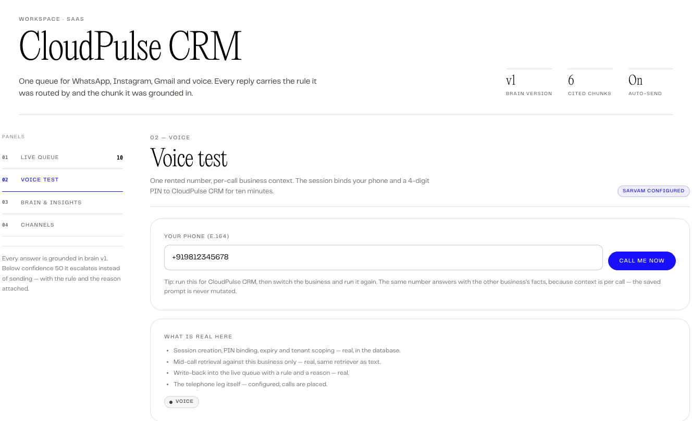
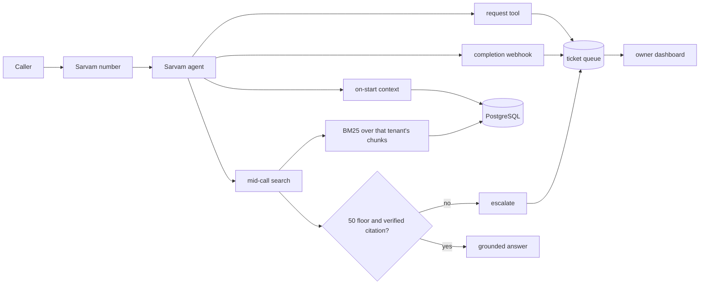
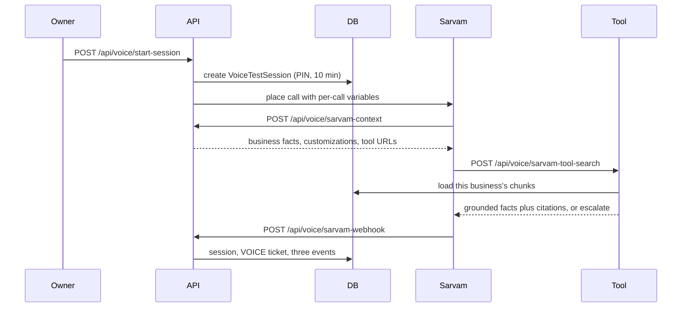

# AfterSales AI

**A phone agent for small businesses that answers from the owner's own facts, cites what it used, and hands the call to a human when it cannot prove the answer.**

Team 41 · SPHINX '26 · PS 2.5 · [Live demo](https://aftersales-sphinx.vercel.app/) · [Repository](https://github.com/dishudhalwal12/aftersales)

Last verified: 31 October 2026. 474 tests pass. Typecheck is clean. The voice gate passes 78/78 checks.

> The MVP is the calling agent. The dashboard, the text channels, and the weekly report exist to show that the same brain works beyond the call.

## At a glance

| | |
|---|---|
| Problem | Small businesses miss calls and messages after hours. Hiring cover is expensive, and a missed call usually becomes a customer who calls someone else. |
| MVP | An AI phone agent that answers from one business's facts, refuses below a confidence floor, and writes every call to a queue. |
| Who pays | Appointment-led small businesses: dental clinics, salons, coaching centres, D2C support desks. |
| What is real | Session binding, tenant-scoped retrieval, the 50 confidence floor, citation checks, request capture, ticket write-back, tenant isolation, 474 tests, a 78-check voice gate. |
| What is not | Calendar confirmation, payments, customer logins, outbound campaigns, live provider handshakes on this deployment. |
| Stack | Next.js 16, React 19, TypeScript, Prisma 6, PostgreSQL, Sarvam Voice Agents, BM25, OpenRouter, Baileys, Laya on MLX. |
| Demo | [Live](https://aftersales-sphinx.vercel.app/), `judge@demo.aftersales.ai`, password `judge-demo-41`. |
| Team | Divyanshu Saini and Pulkit Khowal. Two people, one vertical slice. |



*The voice panel in the local build. The badge reports whether Sarvam keys are configured. Without them, the panel says dry run.*

## If you have five minutes

1. Open the [live demo](https://aftersales-sphinx.vercel.app/) and sign in with the demo account.
2. Open **Voice test**. Enter a phone number in E.164 form, for example `+919812345678`, and press **Call me now**.
3. If the deployment has Sarvam keys, the phone rings. If it does not, the panel says **dry run** and the session, retrieval, and write-back still run. The panel tells you which mode you are in.
4. Ask the CloudPulse business: "What is the price of the Pro Plan and does it include WhatsApp invoicing?" You should see ₹1,499 and a citation such as `chk_cp_02`.
5. Switch the business to **Jaipur Smile Studio** and ask the same question. The clinic should score below 50, cite nothing, and escalate. The same number, a different business, no shared prompt.
6. Open **Live queue**. The finished call is a `VOICE` ticket with a transcript, duration, rule, and reason.

## The 9:40 pm call

At 9:40 pm, the front desk at a dental clinic in Jaipur closed at eight. A patient calls about a crown that came off. The phone rings out. By morning, the patient has booked with another clinic.

That scene is a composite of the calls this product is built for. It is not a recorded customer call. The clinic, the prices, and the hours in the demo are seeded content, and the README says so later.

A small business does not lose after-hours customers because the owner does not care. It loses them because one person cannot be at the desk, on the phone, and with a customer at the same time. The same gap appears on WhatsApp at 11 pm and in the inbox on Sunday.

Invoca's platform data puts the average unanswered rate for sales calls at 26%, with some industries above 60%. That is US data from a vendor that sells call recovery. We use it as a directional signal, not an India market size. Sarvam lists voice agents at ₹3.50 a minute on pay as you go, checked October 2026. At 300 minutes a month, the voice bill is ₹1,050. That is the cost line that makes a ₹3,999 plan possible.

## The MVP: one call, start to finish

The owner teaches the business once. The four-step onboarding asks for identity and tone, products and prices, policies and FAQs, and escalation contacts. The answers compile into a versioned markdown brain, then into six knowledge chunks per seeded business. The owner can edit a price at 9 am and the 9:05 call will quote the new price, because saving core facts rebuilds the chunks and bumps `brainVersion` in the same transaction.

Before the call, the owner opens **Voice test**, enters a phone number, and presses **Call me now**. The server creates a `VoiceTestSession` with a four-digit PIN and a ten-minute expiry. It loads the business's call context and customizations, builds the per-call variables, and asks Sarvam to place the call.

The shared Sarvam agent prompt is never edited per business. The prompt holds placeholders only. Business name, services, hours, holidays, languages, FAQs, tone, escalation numbers, and the tool URLs travel as per-call variables. That is the design choice that lets one rented number answer for two businesses without leaking one price list into the other.

During the call, the agent does not answer from model memory. When a caller asks a substantive question, Sarvam calls `POST /api/voice/sarvam-tool-search`. The server resolves the session to exactly one business, loads that business's chunks, runs BM25 over the top four, and applies the same confidence floor the text path uses.

If the answer is grounded, the agent speaks one or two sentences and the response carries the cited chunk ids. If the score is below 50, or no chunk supports the answer, the response is the literal string "I do not have a grounded answer for that," followed by a human handoff. The caller hears a refusal, not a guess.

The agent can also take an appointment request, a reschedule request, a cancellation, or a callback request. It never confirms one. `confirmed` is the literal `false` in every response, because this deployment has no calendar integration. The request becomes a `VOICE` ticket in the owner's queue, marked as pending. The agent tells the caller the business still has to confirm.

When the call ends, Sarvam posts the transcript, duration, and outcome to `POST /api/voice/sarvam-webhook`. The route writes the session, a `VOICE` ticket, and three append-only events in one transaction. The ticket carries the rule that decided the outcome. A replay of the same call returns the original ticket with `duplicate: true` and does not overwrite the first transcript.

The two-business demo is the proof. CloudPulse CRM answers the Pro Plan question with ₹1,499 and `chk_cp_02`. Jaipur Smile Studio gets the same question, scores 20, cites nothing, and says a human from the clinic can help. The shared number was never mutated. The business was a per-call variable.

## What the caller hears

This is a scripted example from the seeded clinic. In a dry run, the panel produces the same exchange. With Sarvam keys, the same payload places a real call.

```text
Caller: Do you do root canals, and what does one cost?
Agent:  Yes. A root canal is ₹4,500 per tooth. A ceramic crown, if you need one, is ₹6,000.

Caller: Can I come in tonight?
Agent:  The clinic is closed now. I can record a callback request for tomorrow,
        and the front desk will confirm the time.

Caller: My crown came off and it is bleeding.
Agent:  That needs a person now. I am marking this as urgent for the clinic.
        If the bleeding is heavy, please call local emergency services.
```

The first answer cites a real chunk. The second records a request and refuses to promise a slot. The third escalates under R1 at urgency 100 and puts the mandatory safety line ahead of the booking flow.

## Why refusing is the feature

A wrong answer on a phone call is worse than a missed call. The caller hears a price, repeats it to a friend, and the owner finds out after the damage. That is why the agent is deliberately boring. It quotes the owner's words, cites the chunk it used, and hands over anything it cannot ground.

The rule is not a prompt instruction. The model returns four fields and a draft. A TypeScript router checks those fields against seven ordered rules. On the voice path, `groundVoiceAnswer` applies the same 50 floor as the text path. Below 50, or zero verified citations, it escalates. The rule is tested at 49 and 50, and the voice path cannot use a different arithmetic.

The first voice build got this wrong. It turned any BM25 hit into a confidence above 50, so the clinic answered the Pro Plan question at 86. It would have read a SaaS price list to a dental patient. We replaced the transform with the text path's `retrievalConfidence`, added `groundVoiceAnswer`, and locked the case in `tests/server/voice/grounding.test.ts`. The same question now scores 20 and escalates.

The agent will not:

- quote a price that is not in the business brain
- confirm an appointment or a cancellation
- diagnose a condition or prescribe medication
- promise a refund outside the saved policy
- speak another tenant's facts
- keep talking after the caller asks for a human

The clinic demo is why the safety instruction cannot be switched off. It tells the agent to send a medical emergency to local emergency services before it tries to book a routine appointment. That line is mandatory, not an owner preference.

## PS 2.5, mapped

The problem statement asks for an agent that reads incoming messages, classifies intent and urgency, drafts replies from a company knowledge base, escalates sensitive cases, and ships with a ticket dashboard. The bonus asks for sentiment tracking and a weekly report.

| PS 2.5 asks for | What we built | Where it lives |
|---|---|---|
| Read emails or chats | WhatsApp, Instagram, Gmail, and a generic webhook; a voice leg on top | `src/app/api/channels/`, `src/app/api/voice/` |
| Classify intent and urgency | A classifier returns four fields; R1 to R7 dispose in TypeScript | `src/server/ai/orchestrator.ts`, `src/server/ai/routing.ts` |
| Draft replies from a knowledge base | Four-step onboarding, versioned brain, BM25 chunks, citations | `src/server/ai/rag.ts`, `src/server/business/service.ts` |
| Escalate sensitive cases | R1, R2, R3, R4, R7; voice uses the same floor | `src/server/ai/routing.ts`, `src/server/voice/grounding.ts` |
| Simple ticket dashboard | Queue, ticket drawer, event trail, human actions | `src/app/dashboard/page.tsx`, `src/components/dashboard/` |
| Sentiment and weekly report | Rolling index plus one immutable report per completed ISO week | `src/server/business/insights.ts`, `src/server/business/weekly-report.ts` |

The voice leg is the MVP. The text channels are the proof that the decision layer is channel-agnostic: the same brain, the same floor, a different door.

## Who pays

The first customers are appointment-led businesses with a phone number and a ticket value high enough to notice one recovered call. Dental clinics fit first: a root canal is ₹4,500 at the seeded clinic, the front desk goes home at 8 pm, and the patient will call someone else before morning. Salons, physio clinics, coaching centres, and D2C support desks have the same shape.

The buyer is the owner. One conversation can close the account. There is no procurement team, no IT ticket, and no integration project.

Our working price:

| Plan | Price | Included minutes | Overage | Who it fits |
|---|---:|---:|---:|---|
| Starter | ₹3,999/month | 300 | ₹6/minute | One clinic or salon |
| Growth | ₹5,999/month | 600 | ₹6/minute | Multi-chair clinic or a small D2C desk |

At 300 minutes, Sarvam costs ₹1,050, leaving about 74% gross margin before model and infrastructure. At 600 minutes, the voice bill is ₹2,100, leaving about 65%. Payment fees and GST are not in that number. The plan is a hypothesis, not a validated price. The first five clinics will test it.

One root canal pays for the Starter plan. The arithmetic comes from the seeded clinic; it is not a conversion claim.

We are not charging per call. Owners hate variable bills, and a phone number that produces a surprise invoice gets switched off. Included minutes with a published overage is easier to budget. We are not doing freemium either. A free number costs us real minutes. A 14-day pilot on one number is the trial.

The first ten customers will come from Jaipur, not from a broad market. We will call 50 clinics after 8 pm, log who answers, and show the owner the log. No ads first. If the missed-call log does not get a meeting, paid traffic will not fix the pitch. Later, local POS vendors and agencies can resell the plan because they already sit beside the owner.

## The competition

| Option | What it does well | Where it leaves a gap |
|---|---|---|
| Human front desk | Trust, judgment, a familiar voice | Goes home at 8 pm; one person cannot answer two calls |
| IVR | Cheap, never busy | Menus frustrate callers; a new question has nowhere to go |
| Horizontal voice AI | Telephony, latency, scale | The owner still has to build the brain, the refusal policy, and the queue |
| Helpdesk software | Ticketing, macros, reporting | Text-first; a caller gets voicemail |
| WhatsApp chatbot | Familiar, cheap | Cannot answer a phone call; menu-bound |
| AfterSales AI | One brain across voice and text, grounded answers, a queue the owner can audit | Narrow by design; no calendar or payments yet |

The horizontal voice platforms are better at telephony scale and latency. We are the last mile: the owner's facts, the refusal policy, and the queue history that makes the answer defensible. We can use a horizontal platform as a supplier later. We do not need to beat it at its own layer.

Sarvam or OpenAI can sell the same model to anyone. The owner's 12 answers, the confidence floor, the citation check, and the queue history are harder to copy.

## What could kill this

Trust. One confident wrong answer can lose an owner who was ready to pay. The current defence is the floor, the citation check, the transcript, and a pilot on one number. If a bad answer still gets through, the next move is owner approval for topics the brain has never seen.

Latency. A two-second pause on a phone feels broken. The voice path uses local BM25, four chunks, and no extra model round trip. If p95 goes past two seconds, we precompute more or move retrieval closer to the call.

Telephony compliance. Outbound calling in India needs the right number, caller ID, and DLT/TRAI paperwork. The demo uses a Sarvam-provided number. A production launch starts inbound-only and gets a legal review before any outbound campaign.

Cost. Voice minutes are the cost of goods. The plan includes a fixed minute pool, the overage is published, and we watch cost per call. If a call costs more than ₹15, we reprice or shorten the conversation.

Language. Hinglish speech recognition is hard. The app is configured for Hindi, English, and code-mixed Hinglish, but that is a configuration, not a measured accuracy claim. We will test with 20 real callers. If accuracy is below 90%, we narrow the promise to Hindi and English before we widen it again.

Distribution. Small business sales is slow. The missed-call audit is the wedge. If customer acquisition cost goes past ₹5,000, we move to partner-led sales with POS vendors and local agencies.

## How we built it

We started with the problem statement, not the stack. The PS allows text or chat; we picked the phone because a missed call is the most expensive kind. A WhatsApp message can wait until morning. A ringing phone cannot.

The first build was the decision layer: a business brain, chunks, BM25, and seven rules. The voice leg came after, because a phone call is unforgiving. If the floor is wrong, the caller hears it.

The Sarvam spike came back conditional. The platform supports per-call variables and mid-call HTTPS tools, which is what we needed. The missing piece was credentials, so we built the dry run first and made the panel tell the truth about it.

The first voice integration still had the 86 bug. We caught it in a probe, not in a demo. The clinic was answering a SaaS price list. We removed the separate score, reused the text floor, and wrote the regression before we touched the UI again.

Two people set the scope. Four channels, seven rules, four panels, one phone number. We cut calendar confirmation, payments, customer logins, and outbound campaigns. Each one is a product by itself. The MVP had to survive the call path before it could grow.

## What we would do next

In the next 30 days: five design partners, real numbers, and 30 days of call logs. Measure answer rate, containment, escalation rate, and cost per call. Add owner approval for appointment confirmation, because a request-only flow is honest but incomplete.

In the next 90 days: a calendar integration, WhatsApp follow-up after a call, outbound reminders, and a multi-location view. The calendar comes after the owner trusts the answer, not before.

The ask: five clinic introductions in Jaipur, Sarvam production credits, and one design partner who will share 30 days of real call logs.

## Under the hood

The rest of this README is for the reader who wants to check the claims. The app is one Next.js 16 codebase. API routes own the trust boundaries. Prisma talks to PostgreSQL. Sarvam runs the phone conversation. BM25 runs retrieval. OpenRouter is optional. Baileys and Laya are local services, and both are optional at runtime.



## One call, end to end

The voice path is five routes around one external voice platform.



### Start the session

`POST /api/voice/start-session` takes `businessId` and an E.164 phone number. It loads the business through `loadOwnedBusiness`, so a foreign id is a 403. It creates a `VoiceTestSession` with a four-digit PIN and a ten-minute TTL, then calls `placeOutboundCall`.

The Sarvam request carries a per-call payload: `session_id`, `business_name`, `demo_pin`, and the business variables. The variables include name, type, description, address, products and services, opening hours, weekly holidays, supported languages, FAQs, appointment policy, return policy, escalation email and phone, tone, agent instructions, the uploaded knowledge file, and the two tool URLs.

Values are sized to the onboarding limits in `src/shared/fact-limits.ts`. If an older row is longer than its budget, the server clips it and reports the variable in `clippedVariables`, so the loss is visible instead of silent.

The response includes `callMode`, `callPlacementOk`, `callPlacementReason`, and `contextInjectionMode: "PER_CALL_VARIABLES"`. Without `SARVAM_API_KEY` and `SARVAM_CALL_ENDPOINT`, the mode is `dry_run` and no call is placed. With both set but no `SARVAM_CONNECTION_ID`, the request is live and rejected with a reason. The session is still real in either case, and the retrieval and write-back still work.

### Resolve the business

`POST /api/voice/sarvam-context` is the on-start hook. It accepts a trusted `agentId` or `virtualNumber`, or the demo fallback of `sessionId` and `demoPin`. A `business_id` in the body is ignored.

The identifier resolver never returns the first match. An unknown identifier is 404. Two businesses on one number, or an agent id and number that point at different businesses, is 409. An inactive mapping is 409. The mid-call tool also returns 410 for an expired session. That refusal is deliberate: a call answered with another tenant's price list is worse than a failed call.

The route returns the composed context, the active customizations, the per-call variables, and a `warnings` array. If `SARVAM_CONTEXT_TOKEN` is not set, it says `contextAuth: "unconfigured"` instead of pretending the endpoint is secured. The shared secret is compared in constant time against `x-saram-token`, `x-sarvam-token`, `x-sarvam-context-token`, or a bearer token.

### Answer mid-call

`POST /api/voice/sarvam-tool-search` takes a query and a session identifier. It resolves the session, loads only that business's chunks, runs BM25 for the top four, and calls `groundVoiceAnswer`.

The function computes `retrievalConfidence`, the same measure the offline text provider uses. It selects up to two chunks that add coverage of the query, then speaks one sentence from each. It drops `Q:` lines so the caller never hears their own question read back, and it strips `A:` markers before ranking.

The response is one of two shapes. A grounded answer carries `groundedFacts`, `citedChunkIds`, `confidenceScore`, and `escalateToHuman: false`. An ungrounded answer carries the fixed refusal, no citations, and `escalateToHuman: true`.

### Capture a request

`POST /api/voice/sarvam-request` handles appointment, reschedule, cancellation, and callback requests. It validates dates as `YYYY-MM-DD`, times as `HH:MM`, and phone numbers as E.164. It resolves the business the same way as the context route, with an owner session allowed for a business the owner owns.

An emergency is the exception. `emergency: true` wins over everything: rule R1, urgency 100, an escalated ticket, and a message that tells the caller to contact local emergency services. An accepted non-emergency request becomes an R5 draft ticket with `confirmed: false` and `pending: true`. If appointment booking is disabled, the tool refuses the request and takes a callback request instead.

The route is idempotent on `externalRequestId`, or on `sessionId + requestType` when the platform does not provide one. Two tool calls for the same request create one ticket; the unique `(businessId, externalMessageId)` pair picks the winner.

### Close the call

`POST /api/voice/sarvam-webhook` accepts either Sarvam's native payload or the dashboard simulator's simpler body. It authenticates with the shared webhook token or the owner's session. It parses the transcript from `interaction_transcript`, preferring `en_text` and falling back to `indic_text`, so a Hinglish call survives the write-back.

The route maps Sarvam's call states into the frozen status enum: `initiated`, `ringing`, `in_progress`, `completed`, `failed`. It verifies every cited chunk against that business's chunk set. It then calls `completionDecision`: a caller who needed a human is R1, a grounded call is R6, and a call with no verified citation is R2.

The ticket idempotency key is `voice:<sessionId>` or `voice:<interactionId>`. A replay returns `duplicate: true` and the original ticket id. Two simultaneous completions race on the unique index; the loser rolls back and returns the winner's ticket.

## The 50 floor

The model proposes. The router disposes. On the text path, the check is:

```ts
if (result.confidence_score < 50 || verifiedChunks.length === 0) {
  return { ruleHit: "R2", ...ESCALATE };
}
```

On the voice path, the same idea lives in `groundVoiceAnswer`:

```ts
if (confidenceScore < VOICE_CONFIDENCE_FLOOR || selected.length === 0) {
  return {
    groundedFacts: UNGROUNDED_REPLY,
    citedChunkIds: [],
    confidenceScore,
    escalateToHuman: true,
  };
}
```

`VOICE_CONFIDENCE_FLOOR` is 50. `UNGROUNDED_REPLY` is "I do not have a grounded answer for that." The route adds who can help, for example "A human from Jaipur Smile Studio can help."

The boundary is tested at 49 and 50. A citation is tested against the business's own chunk set. A fabricated id, or an id from another tenant, counts as zero grounding. If one real citation remains, the answer can still pass; if none remain, R2 escalates.

The old voice bug is the reason this section exists. The first implementation used a BM25 transform that made any match look confident. The clinic scored 86 on the Pro Plan question. We removed the separate arithmetic and reused the text floor. The regression is in `tests/server/voice/grounding.test.ts`.

The text path keeps all seven rules. First match wins.

| Rule | Condition | Outcome |
|---|---|---|
| R1 | The customer asks for a person | Escalate |
| R2 | Confidence below 50, or no verified citation | Escalate |
| R3 | Distress, or a case that needs human judgment | Escalate |
| R4 | Urgency at or above 80 | Escalate |
| R5 | The channel is draft-only | Hold as draft |
| R6 | Grounded, confident, calm | Auto-reply |
| R7 | Classifier failure, bad JSON, missing key | Fail safe, nothing sent |

A human closes an escalation. The agent has no path from `escalated` back to `replied`. The dashboard's approve and resolve actions are the only exits.

## Tenant isolation

The owner is the only authenticated principal. End customers never log in. Every owner API request that names a business goes through `loadOwnedBusiness`, and a foreign `businessId` is a 403, not a filtered list.

The voice path has its own trust rules. A caller-supplied `business_id` is ignored. The business comes from a `VoiceTestSession`, or from a `virtualNumber` or `agentId` that the database maps to exactly one business. The mapping is intentionally not a database unique constraint, because the resolver must be able to see two rows and refuse the call. Two concurrent owner saves could still create a duplicate, and the resulting calls fail closed with a 409.

A four-digit PIN is a demo capability, not production authentication. It scopes a ten-minute session for a judge. A production deployment should use a signed token from the telephony provider. The README says this because a short PIN is guessable, and pretending otherwise would be silly.

The queue's idempotency key is `(businessId, externalMessageId)`. A provider message id is tenant-scoped, so one tenant's replay cannot read another tenant's ticket. A webhook replay returns the original ticket with `duplicate: true`.

Provider secrets never reach the browser. Gmail and Meta tokens are encrypted with AES-256-GCM before they enter `ChannelConnection.configJson`. OAuth state is HMAC-signed and tenant-bound. Meta webhooks are checked against `X-Hub-Signature-256`. Baileys callbacks use a shared secret. The weekly cron uses a bearer token. The voice context secret is compared with `timingSafeEqual`.

## The rest of the stack

### The business brain

The onboarding wizard saves twelve answers, compiles a markdown brain, and chunks it into six sections. A save that changes a core fact deletes the old chunks, writes the new ones, and bumps `brainVersion` in one transaction. The text and voice paths both call `loadBusinessChunks`, so they cannot disagree about a price.

Retrieval is BM25, not embeddings. That keeps it deterministic, cheap, and easy to inspect. It also means a question that uses a synonym the brain never uses can miss. The next step is hybrid retrieval, not a larger prompt.

### Text channels

The generic webhook, WhatsApp, Instagram, and Gmail all land in the same queue. The text path runs the classifier, the R1 to R7 router, and the channel's auto-send policy. A draft-only channel becomes R5. An escalated ticket waits for a human.

WhatsApp is a local Baileys bridge. It pairs with a QR code, answers 1:1 text messages, and ignores groups and the owner's own messages. Baileys is an unofficial WhatsApp Web client, so the ToS and ban risk are declared, not hidden. If the bridge breaks, one channel degrades.

Instagram's API code exists, but the dashboard card is disabled and says "to be launched." Gmail has a real OAuth flow, token refresh, RFC 5322 MIME, polling, and duplicate suppression, but no live mailbox was available in this environment. The cards report what the backend measured.

### Weekly insights

Sentiment is stored on each ticket. The dashboard shows a 0 to 100 index over the last seven days and compares it with the seven days before. The weekly report is a separate, immutable snapshot: one row per completed ISO week, keyed on `(businessId, weekStart)`.

The report can be generated lazily on the first owner view or by `GET /api/cron/weekly-insights`, which runs on `vercel.json` every Monday at 00:05 UTC. Both paths upsert the same row, so a retry does not duplicate it and a second read does not move `generatedAt`. It ranks recurring complaints that are both repeated and negative or escalated, with `new`, `rising`, `cooling`, and `steady` deltas. Email delivery is not claimed; the report lives in the dashboard and the API.

### Laya, advisory

`laya-service/` runs a local Laya model on Apple silicon through MLX. It asks eight fixed questions about each inbound message: does this need attention within the hour, how urgent is it on a three-level scale, what is the intent, how frustrated is the sender on a four-level scale, did they ask for a human, is the case sensitive, did they ask for money back, and what is the churn risk.

The decision sheet lives on the ticket and appears beside the classifier's numbers. No routing rule reads it. If the model is unreachable, slow, or wrong, the ticket loses a second opinion and nothing else. The failure is recorded with a reason instead of leaving a blank panel.

## Data model

The database is PostgreSQL through Prisma. The schema has no migrations folder; `prisma db push` applies it.

| Table | What it holds | Why it matters |
|---|---|---|
| `User` | Owner account | The only authenticated principal |
| `Business` | Facts, compiled brain, `brainVersion` | One row per tenant; the owner boundary |
| `KnowledgeChunk` | Section, content, keywords | The unit of retrieval and citation |
| `VoiceTestSession` | PIN, phone, status, transcript, duration, outcome | The identity of one demo call |
| `BusinessVoiceAgentContext` | Address, holidays, languages, appointment policy, instructions, number and agent mapping | The call script the brain does not carry |
| `BusinessVoiceAgentCustomization` | Seven types of call rules | Availability, booking, cancellation, rescheduling, callback, urgent, business instructions |
| `Ticket` | Channel, state, intent, urgency, confidence, rule, answer, citations, decision sheet | One queue for every channel |
| `TicketEvent` | Type and JSON payload | Append-only trail; the drawer renders each step |
| `WeeklyInsightReport` | One completed week | Unique on `(businessId, weekStart)`; immutable once written |

`ChannelConnection` stores the provider state and encrypted credentials. `Ticket.externalMessageId` is the duplicate guard, and it is unique per business, never globally.

## What is real, what is simulated

This table is the source of truth. If a capability is not here, treat it as a roadmap item.

| Capability | Status | What is behind it |
|---|---|---|
| Voice session, PIN, expiry, tenant scoping | REAL | `start-session`, `VoiceTestSession`, 10-minute TTL, 403/404/409/410 paths |
| Per-call context and shared prompt safety | REAL | `sarvam-context`, per-call variables, trusted identifier resolver |
| Mid-call retrieval and 50 floor | REAL | `sarvam-tool-search`, `groundVoiceAnswer`, `retrievalConfidence` |
| Citation verification | REAL | `verifiedCitations` against the tenant's chunk set |
| Appointment, reschedule, cancellation, callback capture | REAL, REQUEST-ONLY | `sarvam-request`, `confirmed: false`, R5 draft or R1 emergency |
| Completion webhook and queue write-back | REAL | `sarvam-webhook`, transaction, three events, idempotent replay |
| Dashboard last-call card | REAL | Reads the completed or failed session from the database |
| Text routing R1 to R7 | REAL | 21 routing tests, including 49/50, urgency 79/80, and R7 |
| Weekly sentiment and recurring complaints | REAL | 30 engine tests, 12 store tests, two generation paths |
| Sarvam telephone leg | CONDITIONAL | Needs `SARVAM_API_KEY`, `SARVAM_CALL_ENDPOINT`, `SARVAM_CONNECTION_ID` |
| OpenRouter classifier | CONDITIONAL | Uses `OPENROUTER_API_KEY`; otherwise a labelled offline classifier |
| Offline classifier | REAL, LABELLED | BM25 coverage and extractive answers; dashboard shows a degraded banner |
| Gmail connect, send, poll | REAL CODE, NOT LIVE-VERIFIED | OAuth, token refresh, MIME, duplicate suppression; no live mailbox here |
| Meta and Instagram API | REAL CODE, UI NOT LIVE | API routes exist; Instagram card is coming soon; no live Meta app here |
| WhatsApp via Baileys | REAL LOCAL BRIDGE, NOT LIVE-VERIFIED | QR pairing, signed callbacks, 1:1 text; needs a phone |
| Laya decision sheet | REAL LOCAL, ADVISORY | Eight typed questions; stored on the ticket; routing never reads it |
| Customer names, ticket history, knowledge base | SEEDED | The rows are seeded; retrieval runs against the authored corpus |
| Calendar confirmation | NOT BUILT | No calendar integration; requests are pending owner action |
| Payments and checkout | NOT BUILT | No payment integration or order mutation |
| Customer logins | NOT BUILT | End customers never authenticate |
| Outbound campaigns | NOT BUILT | No dialer or campaign builder |

## Run it

You need Node 22.9 or newer and a PostgreSQL database. Laya needs Python 3.11, `uv`, and Apple silicon. Baileys needs a phone for the QR scan. Both local services are optional.

```bash
npm install
cp .env.example .env
# set DATABASE_URL and DIRECT_URL to your PostgreSQL database
# set AUTH_SECRET to at least 16 characters
npm run db:setup
npm run dev
```

`npm run dev` starts the web app, Laya, and the Baileys bridge in one terminal. It generates a shared secret for each local service and moves to the next free port if one is busy. `npm run dev:web` starts Next.js alone. `npm run db:setup` runs `prisma db push` and the seed.

The seed creates two businesses owned by the demo account, one foreign tenant, six chunks per business, and 18 tickets. The demo account is:

```text
email:    judge@demo.aftersales.ai
password: judge-demo-41
```

The 1-click judge button was removed from `/auth` in the current branch. Use the email and password form. The demo account owns CloudPulse CRM and Jaipur Smile Studio. Nimbus Billing belongs to another user and exists to prove the 403.

The voice panel works without Sarvam keys. It says **dry run**, creates the session, runs the scoped retrieval, and lets you record the ticket. With the Sarvam values set, it places the call. The panel never pretends a dry run is a live call.

The voice keys:

| Key | Without it |
|---|---|
| `SARVAM_API_KEY` | The panel is a dry run |
| `SARVAM_CALL_ENDPOINT` | No outbound URL; the panel is a dry run |
| `SARVAM_CONNECTION_ID` | The call request cannot name the Sarvam connection |
| `SARVAM_AGENT_ID` | The agent template cannot be addressed |
| `SARVAM_VIRTUAL_NUMBER` | The caller ID is not sent |
| `SARVAM_WEBHOOK_TOKEN` | The completion webhook needs an owner session |
| `SARVAM_CONTEXT_TOKEN` | The context route runs unauthenticated and says so |
| `PUBLIC_WEBHOOK_BASE_URL` | The request origin is used to build tool URLs |

Every other key has a truthful degraded path in `.env.example`. With a PostgreSQL URL, the app runs even when the optional keys are empty. The text path uses the offline classifier and labels it. The dashboard cards report themselves unconfigured instead of pretending to be connected.

## Tests and proof

`npm test` runs the native Node test runner. On 31 October 2026 it reported 474 tests, 102 suites, 0 failures. `npm run typecheck` is clean. The voice gate boots the real app against PostgreSQL, drives the routes over HTTP, checks the rows, and removes what it created: 78/78 checks pass. The weekly gate passes 43/43.

| Claim | Evidence |
|---|---|
| Below 50 never auto-sends | `tests/server/ai/routing.test.ts` checks 49, 50, and 0 |
| A foreign citation is not grounding | `tests/server/ai/routing.test.ts`, `tests/server/voice/completion.test.ts` |
| Voice answers only from the called business | `tests/server/voice/grounding.test.ts`, `npm run verify:phase4` |
| A FAQ question is not spoken back | `tests/server/voice/grounding.test.ts` |
| Appointment requests are never confirmed | `src/server/voice/customizations.ts`, `src/app/api/voice/sarvam-request/route.ts` |
| A replay is one ticket | `voice:<sessionId>`, unique `(businessId, externalMessageId)`, `verify:phase4` |
| Another tenant gets a 403 | `loadOwnedBusiness`, `tests/server/auth/`, live gate |
| A secret never reaches the page | `verify:phase4` AT-12, fake key assertion |
| 474 tests pass | `npm test` |

The unit suite covers pure logic. The gates cover the parts that only fail when the app, the database, and the HTTP boundary meet.

## Repository map

```text
src/app/api/voice/           five voice routes
src/server/voice/            Sarvam client, context, grounding, customizations, completion
src/server/ai/               classifier, R1-R7 router, BM25 retrieval
src/server/business/         tickets, insights, weekly report
src/components/dashboard/    voice panel, context panel, customization panel
prisma/schema.prisma         data model
prisma/seed.ts               two demo tenants, one foreign tenant, 18 tickets
scripts/verify-phase4.mjs    voice gate
scripts/verify-weekly-report.mjs
tests/                       474 tests, 102 suites
baileys-service/             local WhatsApp bridge
laya-service/                local typed-decision model
docs/ARCHITECTURE.md         diagrams and trust boundaries
docs/spikes/SARVAM.md        voice spike and per-call context
docs/ENV-SETUP.md            step-by-step environment guide
```

More detail: [architecture](docs/ARCHITECTURE.md), [demo script](docs/DEMO-SCRIPT.md), [environment guide](docs/ENV-SETUP.md), [Sarvam spike](docs/spikes/SARVAM.md), [capability notes](docs/product/CAPABILITY.md).

## Known limits

The telephone leg is configuration, not a claim. Without `SARVAM_API_KEY` and `SARVAM_CALL_ENDPOINT`, the panel is a dry run. With those two but no `SARVAM_CONNECTION_ID`, the request is live and rejected. The session, retrieval, citation check, and ticket write-back are real in both modes.

There is no calendar. Appointment requests are recorded and left pending. `confirmed` is the literal `false`.

The knowledge base is authored sample material. Retrieval runs against that corpus, not a customer's.

Gmail, Meta, WhatsApp, and Instagram have real API code and unit tests, but no live provider account was available here. The cards report what the backend measured. Instagram's card is disabled for launch.

The offline classifier is a BM25 scorer with extractive answers. It returns sentences from the top chunks, so answers read like the brain's own words. It exists so the routing contract works without a key, and the dashboard labels it.

The PIN is four digits. It scopes a ten-minute demo session, not a production account. A real deployment should use a signed telephony token.

Call transcripts have no retention policy yet. A production version needs configurable retention and redaction before it handles a real clinic's patients.

BM25 is cheap and deterministic, but it misses synonyms. Hybrid retrieval is the next step.

No load test has been run. The design keeps the voice turn to one retrieval call, but p95 latency is not measured.

## Team

Team 41 is Divyanshu Saini and Pulkit Khowal. The two of us built the voice path, the dashboard, the data model, the channel adapters, and the tests. The team is two people, which is also why the scope is four channels, seven rules, four panels, and one phone number.

Repository: [github.com/dishudhalwal12/aftersales](https://github.com/dishudhalwal12/aftersales)

Live demo: [aftersales-sphinx.vercel.app](https://aftersales-sphinx.vercel.app/)

If you only have one minute left, open the voice panel, call CloudPulse, then switch to the clinic and ask the same question. One answer cites a chunk; the other escalates.
