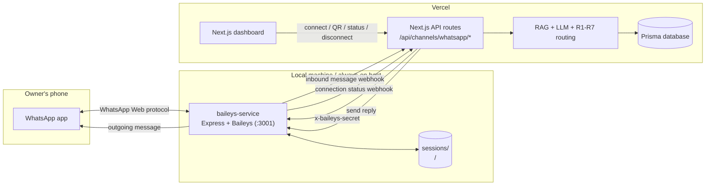

# AfterSales AI — Local WhatsApp Service (Baileys)

A small, standalone Node.js + TypeScript service that links a WhatsApp number through
[Baileys](https://github.com/WhiskeySockets/Baileys) and bridges it to the existing AfterSales AI
backend. It runs on the owner's machine (or any always-on host), not on Vercel.

This service is intentionally separate from the Next.js app:

- it owns every WhatsApp socket and every Baileys credential;
- the Next.js backend owns tenants, tickets, RAG, LLM triage, and routing;
- the two talk over HTTP with a shared secret in both directions.

No frontend code, database schema, or AI logic was changed to add this integration.

---

## Project Overview

```
owner dashboard (Vercel)
        |  session cookie
        v
Next.js API routes  --- x-baileys-secret --->  this service (:3001)  <--- WhatsApp Web ---> phone
        ^                                            |
        |  inbound message + status webhooks         |
        +--------------------------------------------+
```

What it does:

1. `POST /connect` opens a Baileys socket for one business's unique `connectionId` and returns a QR
   data URL.
2. The owner scans the QR from **WhatsApp → Linked Devices**. The socket opens and the service posts
   a `connected` status event to the Next.js backend.
3. Incoming text messages are forwarded to `POST /api/channels/whatsapp/inbound`. The backend runs
   the existing RAG → LLM → R1–R7 pipeline, creates the ticket, and (only when routing allows
   auto-send) calls this service's `POST /send` with the answer.
4. Reconnects, QR refreshes, logouts, and disconnects are handled per connection; one business's
   failure never affects another.

Multi-business support is per connection: each business has its own connection id and its own
credential folder under `SESSION_STORAGE_PATH`. There is no shared credential file.

---

## Architecture



In a production setup the `API --> SVC` edge goes through a tunnel (for example ngrok), because
Vercel cannot reach `localhost`. The `SVC --> API` edges do not need a tunnel: the Vercel backend is
already publicly reachable. See [Running locally](#running-locally) and
[Troubleshooting](#troubleshooting).

---

## Prerequisites

- Node.js 20 or newer (developed on Node 24) and npm.
- A WhatsApp account you are willing to link as a device. Use a **secondary or demo number** — this
  is an unofficial client (see [Important Limitations](#important-limitations)).
- The AfterSales AI backend running (locally on port 3000, or deployed on Vercel) with
  `BAILEYS_SERVICE_URL` and `BAILEYS_SERVICE_SECRET` configured.
- A tunnel (ngrok, Cloudflare Tunnel, etc.) if the Next.js backend is deployed and must reach the
  service on your machine.

---

## Installation

```bash
cd baileys-service
npm install
cp .env.example .env
```

`npm install` installs Baileys, Express, zod, qrcode, tsx, and the test tooling. Production audits
may report advisories in Baileys' transitive dependencies; this is an unofficial WhatsApp client and
advisories should be reviewed when upgrading.

---

## Environment Configuration

| Variable | Required | Default | Purpose |
| :--- | :--- | :--- | :--- |
| `PORT` | no | `3001` | HTTP port for this service. |
| `BAILEYS_SERVICE_SECRET` | **yes** | none | Shared secret with the Next.js backend. Minimum 16 characters. The service refuses to start without it. Must be identical to `BAILEYS_SERVICE_SECRET` on Vercel. |
| `VERCEL_BACKEND_URL` | one of these two | none | Base URL of the Next.js backend (local `http://localhost:3000` or your deployment). Used to derive the webhook URLs. |
| `VERCEL_WEBHOOK_URL` | one of these two | `${VERCEL_BACKEND_URL}/api/channels/whatsapp/inbound` | Full URL for inbound WhatsApp messages. |
| `VERCEL_STATUS_WEBHOOK_URL` | no | `${VERCEL_BACKEND_URL}/api/channels/whatsapp/status` | Full URL for connection status events. |
| `SESSION_STORAGE_PATH` | no | `./sessions` | Root folder for per-connection Baileys credentials. One sub-folder per `connectionId`. **Equivalent to a password — never commit it.** |
| `CONNECT_WAIT_MS` | no | `10000` | How long `POST /connect` waits for the first QR/open event before replying. |
| `WEBHOOK_TIMEOUT_MS` | no | `10000` | Timeout for one webhook delivery attempt. |
| `RECONNECT_MAX_DELAY_MS` | no | `30000` | Cap for exponential reconnect backoff (1s, 2s, 4s, ...). |
| `LOG_LEVEL` | no | `info` | `debug`, `info`, `warn`, or `error`. Credentials are never logged at any level. |

Generate a secret:

```bash
node -e "console.log(require('crypto').randomBytes(32).toString('hex'))"
```

Set the **same value** in the Next.js app's `.env`:

```bash
BAILEYS_SERVICE_URL="http://localhost:3001"   # or the tunnel URL when deployed on Vercel
BAILEYS_SERVICE_SECRET="<same secret>"
BAILEYS_TIMEOUT_MS="15000"                    # must exceed CONNECT_WAIT_MS (default 10s)
```

---

## Running locally

There are two networking directions. Keep them straight:

- **Next.js → service** uses `BAILEYS_SERVICE_URL`. Locally this is `http://localhost:3001`; on a
  Vercel deployment it must be a public tunnel URL.
- **Service → Next.js** uses `VERCEL_WEBHOOK_URL` / `VERCEL_STATUS_WEBHOOK_URL`. Locally this is
  `http://localhost:3000/...`; when Next.js is deployed, use the deployed URL (public, no tunnel
  needed).

1. **Install** the service dependencies: `cd baileys-service && npm install`.
2. **Create** the service env file: `cp .env.example .env`.
3. **Generate** a shared secret:
   `node -e "console.log(require('crypto').randomBytes(32).toString('hex'))"`.
4. **Fill in** `.env`: `BAILEYS_SERVICE_SECRET` (the generated value), and either
   `VERCEL_BACKEND_URL` or both webhook URLs.
5. **Mirror the secret** into the Next.js `.env` as `BAILEYS_SERVICE_SECRET` and set
   `BAILEYS_SERVICE_URL` (`http://localhost:3001` when running Next.js locally).
6. **Start the Next.js backend** (from the repository root) with its database ready:
   `npm install && npm run db:push && npm run db:seed && npm run dev`.
7. **Expose the backend** if it is deployed (skip when Next.js runs locally): make sure
   `VERCEL_WEBHOOK_URL` and `VERCEL_STATUS_WEBHOOK_URL` point at the public deployment.
8. **Expose this service** if Next.js is deployed: start a tunnel to port 3001
   (`ngrok http 3001`) and set `BAILEYS_SERVICE_URL` on Vercel to the tunnel URL. Redeploy so the
   environment change is picked up.
9. **Start the service**: `npm run dev` (or `npm start`). It logs
   `listening on http://localhost:3001` and the webhook targets.
10. **Verify health** (public, no secret): `curl http://localhost:3001/health`.
11. **Sign in** to the dashboard (judge demo login) and open the WhatsApp channel for a business.
12. **Click Connect WhatsApp.** The backend mints a `connectionId`, calls the service, and returns
    the QR data URL. Scan it with **WhatsApp → Linked Devices → Link a device**.
13. **Confirm the connection.** The service posts a `connected` status event; the backend flips the
    `ChannelConnection` to `CONNECTED` and stores the phone number. `GET /health` shows
    `connections.connected: 1`.
14. **Send a WhatsApp message** to the linked number. The backend creates a ticket in the Live Queue
    and, when routing allows auto-send on a connected channel, replies through this service. Use
    **Disconnect** (logout) when finished; logging out deletes the credential folder for that
    connection.

To test the service alone without WhatsApp credentials:

```bash
npm test          # 29 tests, mocked sockets, no real account
npm run typecheck
```

---

## Development Commands

| Command | Purpose |
| :--- | :--- |
| `npm run dev` | Start on `PORT` with `tsx watch` (reload on file changes). |
| `npm start` | Start once with `tsx` (no watch). |
| `npm run typecheck` | `tsc --noEmit`. |
| `npm test` | Vitest suite (fake sockets, fake fetch, no WhatsApp account). |
| `npm run test:watch` | Vitest in watch mode. |

---

## HTTP API

All endpoints except `GET /health` require:

```
x-baileys-secret: <BAILEYS_SERVICE_SECRET>
```

Errors use one envelope:

```json
{ "error": { "code": "CONNECTION_NOT_FOUND", "message": "That WhatsApp connection does not exist." } }
```

`401 UNAUTHORIZED` is returned for a missing/wrong secret, `429 RATE_LIMITED` after 60 write requests
per minute per IP, `400 VALIDATION_ERROR` for bad payloads, and `500 INTERNAL_ERROR` as a last resort.
`POST /connect`, `POST /disconnect/:connectionId`, and `POST /send` are rate-limited.

### `GET /health`

Public. Never includes secrets, phone numbers, QR payloads, or session paths.

```json
{
  "status": "ok",
  "service": "aftersales-baileys",
  "time": "2026-10-31T10:00:00.000Z",
  "uptimeSeconds": 42,
  "connections": { "total": 1, "connected": 1 }
}
```

### `POST /connect`

Body:

```json
{ "connectionId": "wa_9f4c...", "businessId": "biz_cloudpulse_01" }
```

- `connectionId` must be 8–80 characters of letters, digits, `_` or `-`. The backend generates it
  with a `wa_` prefix; reuse the same id to resume a saved session.
- `businessId` is bound to the connection. Reusing a `connectionId` with a different business
  returns `403 FORBIDDEN`.
- Calling `/connect` again while a socket is live returns the current snapshot and never opens a
  second socket.
- Waits up to `CONNECT_WAIT_MS` for the first QR or open event.

Response (snapshot):

```json
{
  "connectionId": "wa_9f4c...",
  "businessId": "biz_cloudpulse_01",
  "status": "qr",
  "qr": "data:image/png;base64,...",
  "qrExpiresAt": "2026-10-31T10:01:00.000Z",
  "connectedAt": null,
  "phoneNumber": null,
  "lastError": null
}
```

Failures: `400 INVALID_REQUEST`, `403 FORBIDDEN`, `502 WHATSAPP_CONNECT_FAILED`.

### `GET /qr/:connectionId`

QR polling endpoint. The `qr` is a PNG data URL and is only present while the status is `qr`.
`qrExpiresAt` is a hint (60 seconds); the UI should keep polling. `404 CONNECTION_NOT_FOUND` when the
service has no such connection (for example after a restart).

```json
{
  "connectionId": "wa_9f4c...",
  "status": "qr",
  "qr": "data:image/png;base64,...",
  "qrExpiresAt": "2026-10-31T10:01:00.000Z",
  "connectedAt": null
}
```

### `GET /status/:connectionId`

```json
{
  "connectionId": "wa_9f4c...",
  "businessId": "biz_cloudpulse_01",
  "status": "connected",
  "qrAvailable": false,
  "connectedAt": "2026-10-31T09:59:12.000Z",
  "phoneNumber": "919812345678",
  "lastError": null
}
```

`status` is one of `connecting`, `qr`, `connected`, `disconnected`, `logged_out`. `404` for unknown
connections.

### `POST /disconnect/:connectionId`

Body:

```json
{ "businessId": "biz_cloudpulse_01", "logout": true }
```

`logout` defaults to `true`. `true` logs the device out of WhatsApp and deletes that connection's
credential folder; `false` only closes the socket and keeps credentials for a later `/connect`.
Returns the snapshot. Failures: `403 FORBIDDEN`, `404 CONNECTION_NOT_FOUND`.

### `POST /send`

Body:

```json
{
  "connectionId": "wa_9f4c...",
  "businessId": "biz_cloudpulse_01",
  "recipient": "919812345678",
  "message": "The Pro Plan costs ₹1,499 per month."
}
```

`recipient` accepts digits with country code, a formatted number (`+91 98123 45678`), or a full
`@s.whatsapp.net` JID. Messages are 1–4096 characters. Response: `{ "messageId": "..." }`.

Failures: `400 INVALID_RECIPIENT` / `INVALID_MESSAGE`, `403 FORBIDDEN` (wrong business for the
connection), `404 CONNECTION_NOT_FOUND`, `409 CONNECTION_NOT_CONNECTED` (socket is not open),
`502 WHATSAPP_SEND_FAILED` (WhatsApp rejected the send). Every failure is logged; there is no
unbounded retry loop.

---

## Webhooks (service → Next.js backend)

Both webhooks carry the same `x-baileys-secret` header. The backend verifies it in constant time and
resolves the tenant from `connectionId`, never from the payload's `businessId`.

### Inbound message

`POST ${VERCEL_WEBHOOK_URL}` (default `/api/channels/whatsapp/inbound`):

```json
{
  "connectionId": "wa_9f4c...",
  "messageId": "3EB0C767D02A9F2F2A1B",
  "sender": "919812345678@s.whatsapp.net",
  "recipient": "919700000000@s.whatsapp.net",
  "text": "What is the price of the Pro Plan?",
  "messageType": "text",
  "timestamp": 1761897600000,
  "direction": "inbound"
}
```

- Only `messages.upsert` events of type `notify` are considered; history sync, appends, status
  broadcasts, group messages, messages sent by the linked account itself, and non-text messages are
  skipped.
- Each WhatsApp message id is kept in a bounded in-memory dedupe cache, and the backend also
  enforces `externalMessageId` idempotency in the database. A repeated delivery never creates a
  second ticket or a second reply.
- Delivery is retried up to 3 times with backoff (0.5s, 1s). After that the failure is logged
  (`inbound forwarding failed`) and the message is dropped — it is never silently discarded without
  a log, and the backend's idempotency makes manual replay safe.

### Connection status

`POST ${VERCEL_STATUS_WEBHOOK_URL}` (default `/api/channels/whatsapp/status`):

```json
{
  "connectionId": "wa_9f4c...",
  "businessId": "biz_cloudpulse_01",
  "status": "connected",
  "phoneNumber": "919812345678",
  "lastError": null
}
```

Sent for `connected`, `disconnected`, and `logged_out` transitions (and on explicit disconnect).
Retried up to 2 times, then logged. The backend stores the status in the channel's `configJson`,
flips `ChannelConnection.status` to `CONNECTED` only while WhatsApp is actually connected, and
restores the previous demo mode (`TEST_MODE`/`DRAFT_ONLY`) on disconnect or logout.

---

## Security model

- **Credentials never leave the machine.** Baileys auth files live under `sessions/<connectionId>/`
  and are read only by this process. They are never returned by the API and never sent to the
  frontend.
- **One shared secret, backend only.** `BAILEYS_SERVICE_SECRET` lives in the service `.env` and the
  Next.js environment. It is never shipped to the browser. Both directions compare SHA-256 digests
  with `timingSafeEqual`.
- **Tenant binding.** `/connect`, `/status`, `/qr`, and `/disconnect` verify that the
  `businessId` belongs to the connection. On the backend, the session owner must own the business
  before a connection id is created or returned, and inbound messages are attributed to the business
  that owns the matching channel row.
- **No credentials in logs.** Request logging records only method, path, status, and duration. Errors
  log message ids and connection ids, never auth material or QR payloads.
- **Git hygiene.** `.env`, `sessions/`, and `dist/` are gitignored here and in the repository root.
- **Rate limits and validation.** Write endpoints are rate-limited; every payload is validated with
  zod; unknown endpoints return a JSON `404`.

---

## Tests

`npm test` runs four Vitest files (29 tests) entirely against fakes — no WhatsApp account, no
network:

| File | Covers |
| :--- | :--- |
| `tests/inbound.test.ts` | Payload shape, extended text, from-me/status/group/non-text skipping, timestamp coercion and truncation, dedupe cache. |
| `tests/webhook-client.test.ts` | Secret header and body, retry-then-success, bounded retries that never throw. |
| `tests/manager.test.ts` | QR snapshot with a single socket, connected status and phone number, cross-business `403`, reconnect with backoff, logout on 401 plus credential removal, logout vs close-only, send validation and `502`, duplicate suppression, shutdown. |
| `tests/app.test.ts` | Public health with no secrets, `401` without the secret, connect + validation, QR/status and `404`, disconnect defaults, send success/`403`/`409`/`404`/`400`, rate limiting, JSON `404`. |

The Next.js side adds `tests/baileys.test.ts` (19 tests) and
`tests/whatsapp-routes.test.ts` (17 route-level tests): service-secret checks, connection id
validation, tenant mapping from `connectionId`, triage + auto-reply through the existing pipeline,
duplicate suppression, status persistence and mode restore, cross-tenant isolation, request
validation, ownership denial, and client payload/error mapping.

Run everything from the repository root:

```bash
npm test                      # Next.js backend, 89 tests
cd baileys-service && npm test # service, 29 tests
```

---

## Troubleshooting

### The QR code does not appear

- Check the service log for `listening on` and any `QR encoding failed` warning.
- Call `GET /status/:connectionId` directly with the secret header, then `GET /qr/:connectionId`.
- `CONNECT_WAIT_MS` may have elapsed before WhatsApp emitted a QR; the socket is still connecting.
  Poll `/qr` for a few seconds, then call `/connect` again.
- If the service says `INVALID_REQUEST`, the backend sent an id outside 8–80 allowed characters.

### The QR code expires

QRs are short-lived. This service reports `qrExpiresAt` (about 60 seconds) and Baileys refreshes the
QR periodically; keep polling `/qr/:connectionId` rather than caching the first image. If the QR is
rejected on the phone, wait for the next one or call `/connect` again.

### WhatsApp does not connect after scanning

- Make sure the phone has internet and the latest WhatsApp version.
- Corporate networks, VPNs, and some proxies block `web.whatsapp.com`; try another network.
- Link a normal WhatsApp account, not a WhatsApp Business API number.
- If it repeatedly fails, stop the service, delete `sessions/<connectionId>/`, and connect again.

### The session does not restore after a restart

- Confirm `SESSION_STORAGE_PATH` is stable and writable and that `sessions/<connectionId>/` exists.
- The service keeps connection state in memory only. After a restart the backend must call
  `/connect` again with the same `connectionId`; the backend returns
  `409 WHATSAPP_RECONNECT_REQUIRED` from `GET /api/channels/whatsapp/connection` until it does.
- Do not copy a session folder between machines unless you move the whole folder intact.

### The tunnel URL changed

- Free tunnel URLs rotate. Update `BAILEYS_SERVICE_URL` on Vercel to the new URL and redeploy.
- Always run the tunnel next to the service; the service itself does not depend on the tunnel for
  its outbound webhooks (Vercel is already public).
- If Next.js runs locally, no tunnel is needed in either direction.

### Vercel cannot reach the local service

- Expected: `localhost:3001` on your laptop is not reachable from Vercel. The backend answers
  `502 BAILEYS_UNAVAILABLE`.
- Start a tunnel to port 3001 (`ngrok http 3001`) and point `BAILEYS_SERVICE_URL` at it.
- Verify from outside with `curl https://<tunnel>/health`; it should return `200` without a secret.
- Check the Vercel runtime logs for `BAILEYS_AUTH_FAILED` versus `BAILEYS_UNAVAILABLE` — the first
  means the secret is wrong, the second means the URL/network is wrong.

### Authentication errors (`401`, `BAILEYS_AUTH_FAILED`)

- `BAILEYS_SERVICE_SECRET` must be byte-for-byte identical on both sides (no trailing spaces or
  quotes).
- The service loads `.env` at startup; restart it after editing the file. The Next.js backend reads
  the variable per request but needs a redeploy on Vercel after changing it.
- If the backend answers `503 BAILEYS_NOT_CONFIGURED`, `BAILEYS_SERVICE_URL` or the secret is unset
  on the backend.

### Webhook failures (inbound messages never reach the dashboard)

- The service logs `inbound forwarding failed` or `status webhook failed` with the HTTP status.
- A `401` from the backend means the secrets differ; a `404` means the URL path is wrong; a timeout
  usually means the backend is not publicly reachable.
- Check `VERCEL_WEBHOOK_URL` and `VERCEL_STATUS_WEBHOOK_URL` (or `VERCEL_BACKEND_URL`) and test them
  with `curl`.
- Delivery is retried (3× inbound, 2× status) and then logged. Since the backend deduplicates by
  WhatsApp message id, replaying a failed message is safe.

### The device was logged out (WhatsApp → Linked Devices removed it)

The socket closes with status code 401. The service marks the connection `logged_out`, deletes that
connection's credential folder, and does not reconnect. The status webhook restores the channel's
demo mode. Click **Connect WhatsApp** again and scan a fresh QR.

### The service is stopped

Incoming messages stop immediately. On restart, sockets are not recreated until the backend calls
`/connect` for each business (the saved sessions are reused, so no new QR is needed if the phone did
not unlink the device). Until then the dashboard should treat the connection as unavailable.

### Port 3001 is already in use

- The service exits with `EADDRINUSE`. Change `PORT` (and `BAILEYS_SERVICE_URL` on the backend) or
  stop the other process.
- Windows: `netstat -ano | findstr :3001` then `taskkill /PID <pid> /F`.
- macOS/Linux: `lsof -i :3001` then `kill <pid>`.

### `429 RATE_LIMITED`

Write endpoints allow 60 requests per minute per IP. This is an in-memory limit; wait a minute or
raise the limit in code if the dashboard really needs more.

---

## Important Limitations

- **Unofficial protocol.** Baileys speaks the WhatsApp Web protocol, which is not an official
  integration. Accounts can be limited or banned. Use a secondary/demo number for the hackathon and
  do not link a number you cannot afford to lose.
- **Text only.** Images, documents, audio, video, reactions, stickers, and captions are ignored.
  Group chats, status broadcasts, and the linked account's own messages are ignored.
- **One number per connection.** Each business has one WhatsApp connection; there is no shared
  multi-tenant inbox on a single number.
- **In-memory registry.** Credentials persist on disk, but connection state does not. After a
  restart the backend must call `/connect` again. There is no automatic resume on service startup.
- **Best-effort webhooks.** Retries are bounded (3 inbound, 2 status); failures are logged and
  dropped. There is no durable outbox; the database idempotency key makes manual replay safe.
- **No final status on shutdown.** Stopping the service closes sockets silently; the backend learns
  the connection is gone when it next calls the service (or on reconnect).
- **Auto-reply is backend-owned.** This service never decides whether to answer; it only sends the
  text the backend asks for, and the backend only asks when routing allows auto-send on a connected
  channel.
- **`@lid` senders.** Some WhatsApp accounts deliver senders as linked-device IDs (`...@lid`) rather
  than phone JIDs. The reply can then fail with `400 INVALID_RECIPIENT`; the ticket is still stored
  and the failure is logged.
- **Rate limiting is per process.** Running multiple instances with the same secret/session folder is
  not supported.
- **No media, read receipts, typing indicators, templates, or broadcast lists.**
- **Frontend wiring is outside this package.** The Next.js API routes are implemented; the dashboard
  UI that displays the QR is the frontend track's responsibility and is not included here.

### Assumptions

- The Next.js backend is the only caller holding `BAILEYS_SERVICE_SECRET`; the browser never calls
  this service directly.
- `connectionId` values are generated by the backend (`wa_` + 32 hex characters) and are globally
  unique.
- The backend resolves tenants from `connectionId` and from the owner session; neither the QR nor the
  inbound payload is trusted to name a business.
- The same machine can reach the backend's webhook URL; when the backend is on Vercel, the machine
  must have outbound internet access (no tunnel needed in that direction).

### Not implemented here

- Dashboard QR modal and connection UI (frontend track).
- Media upload/download, message templates, and group messaging.
- A durable webhook queue/outbox or cross-process dedupe.
- Automatic re-registration of saved sessions when the service boots.
- HMAC request signing beyond the shared secret header.
