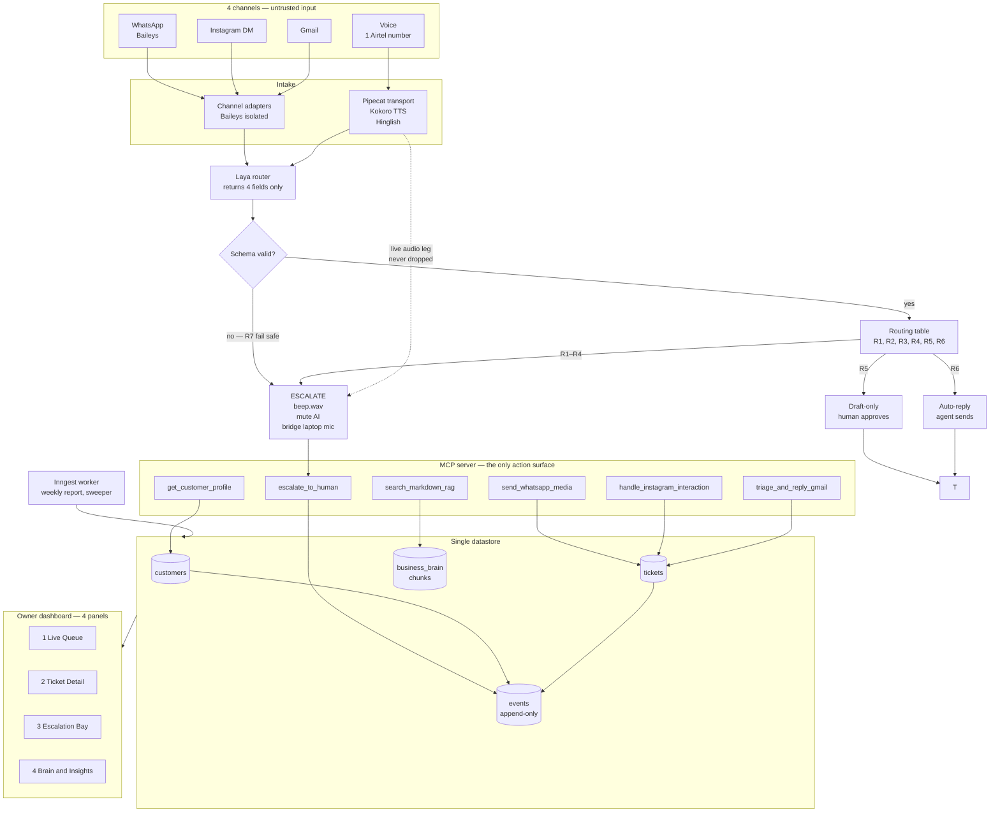
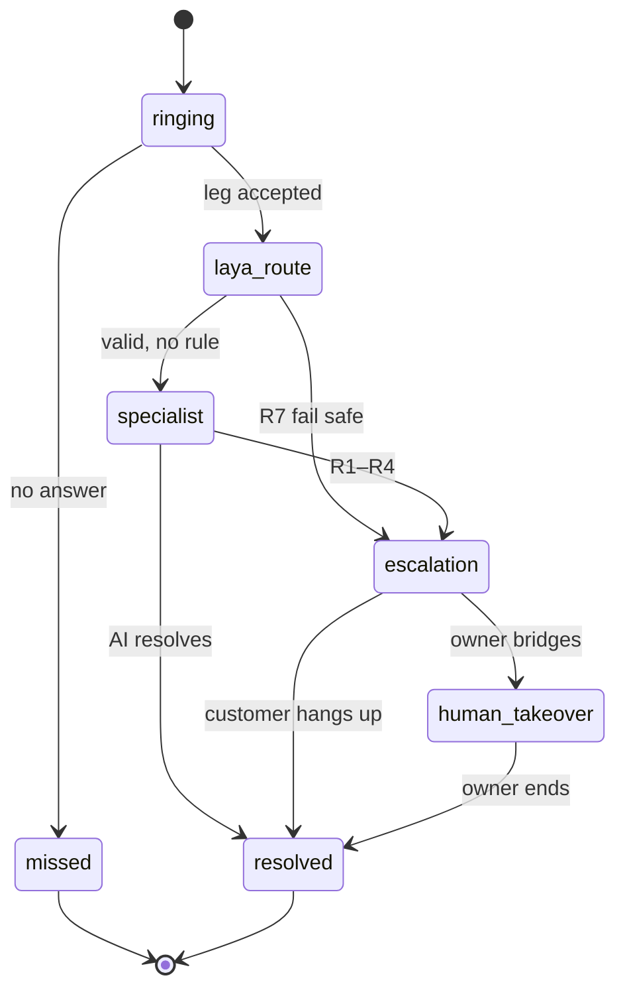
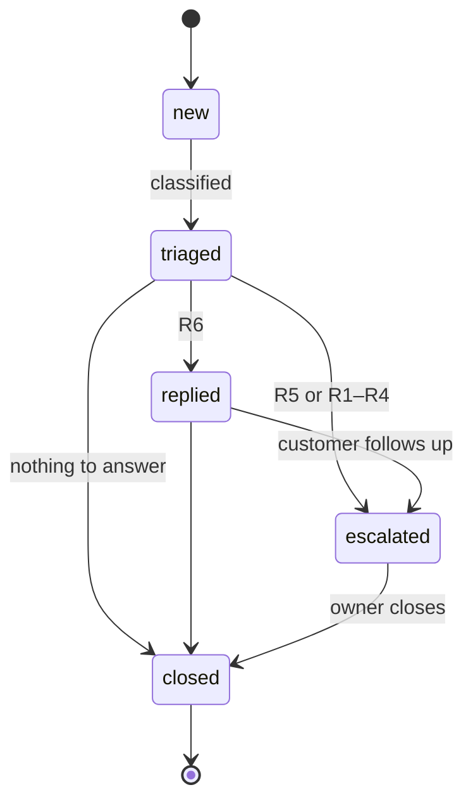

# Architecture — Team 41, PS 2.5

> Derived from `docs/product/CAPABILITY.md` (rev 1). **No implementation claims beyond the
> "Built today" section.** Where a box is not built yet, it says so.

## Shape in one paragraph

Four untrusted channel adapters feed one classifier (**Laya**), which returns exactly four fields.
One ordered rule table (R1–R7) turns those fields into exactly three outcomes: escalate, draft-only,
auto-reply. The agent's only action surface is a **6-tool MCP server**; it has no shell, no raw HTTP,
no database handle. Escalation never hands off — it **bridges the existing audio leg** to the owner's
laptop. One append-only `events` table makes every decision visible on the dashboard, because a
judge-visible reason code is worth more than a log line.

## System diagram



Only the part above `Routing table` runs on the voice path. **Text and voice share one classifier
and one retriever** — four channels, one brain, not four pipelines.

## Routing table — the decision surface

First match wins. `confidence_score` and `urgency` are integers 0–100.

| Rule | Condition | Outcome | Why it exists |
|---|---|---|---|
| **R1** | `intent = human_escalation` | escalate · `explicit_request` | The customer asked for a person |
| **R2** | `confidence_score < 50` | escalate · `low_confidence` | **The product.** A coin flip is never an answer |
| **R3** | `sentiment = distressed` | escalate · `distressed` | Distress outranks confidence |
| **R4** | `urgency ≥ 80` | escalate · `urgent` | Money and outages do not wait for a draft |
| **R5** | `50 ≤ confidence < 70` | draft-only | Good enough to draft, not to send |
| **R6** | `confidence ≥ 70`, `urgency < 80` | auto-reply | The repetitive volume, handled |
| **R7** | invalid output, no match, timeout | escalate · `invalid_decision` | A broken router is never a silent reply |

## State machines

**CALL** — the leg id is immutable and only terminal states release it. A transfer is not
discouraged, it is **unrepresentable**.



**TICKET** — note the absence of an `escalated → replied` edge. F9 is structural, not a policy
comment.



## Data model — 4 entities

| Entity | Holds | Note |
|---|---|---|
| `customers` | phone, email, `plan_tier Free\|Pro`, `last_login`, `recent_orders`, `account_status` | `last_login` semantics **open** — no customer ever logs in (`AQ-19`) |
| `tickets` | channel, customer ref, state, intent, urgency, sentiment, confidence, `laya_raw`, escalation ref | One row per inbound contact, voice included |
| `events` | ticket/call ref, type, actor, payload, timestamp | **Append-only.** This is the audit log the dashboard reads |
| `business_brain.md` chunks | doc version, heading path, text, tokens, embedding ref | The markdown file is the source of truth; chunks are derived and rebuildable |

## Trust boundaries

| Boundary | Treated as | Consequence |
|---|---|---|
| Laya output | **Untrusted** — schema-validated before use | Invalid → R7 → beep. Never a coerced guess |
| Channel webhooks / Baileys session | Untrusted | Adapters normalize; nothing downstream sees raw provider payloads |
| Stored rows read back | Untrusted | An unknown state returns `ILLEGAL_TRANSITION`, never a thrown error |
| Tool results | Frozen envelopes | A caller cannot mutate a decision after the fact |
| The end customer | Never authenticated | Zero customer credentials exist to leak |

## Built today

| | |
|---|---|
| **Real** | Routing table R1–R7 · CALL + TICKET machines · typed tool envelope — 68 tests, 100% branch, mutation-checked |
| **Contract only** | 6 tool signatures, 4 entities, 4 panels, 2 jobs |
| **Not started** | Every network edge in the diagram above |

The README's *real vs mocked* table is the single source of truth for status; this document is the
shape, not the status.

## Export to PNG

```bash
# extract the system diagram, then render it
awk '/^```mermaid$/{n++} n==1 && !/^```/{print} /^```$/ && n==1 && NR>1 && f{exit} {if(/^```mermaid$/)f=1}' docs/ARCHITECTURE.md > /tmp/arch.mmd
npx -y @mermaid-js/mermaid-cli -i /tmp/arch.mmd -o docs/img/architecture.png -w 2400 -b "#0A0A0A"
```

Legibility check: the diagram must still read at **50% zoom**, because that is how it appears on a
slide and in Round 1's 30-minute screen.
