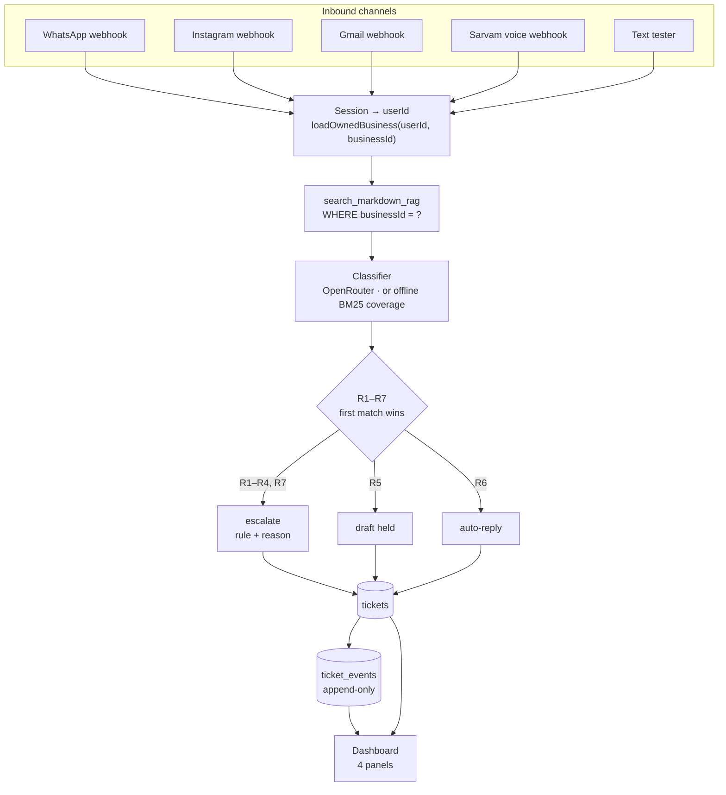
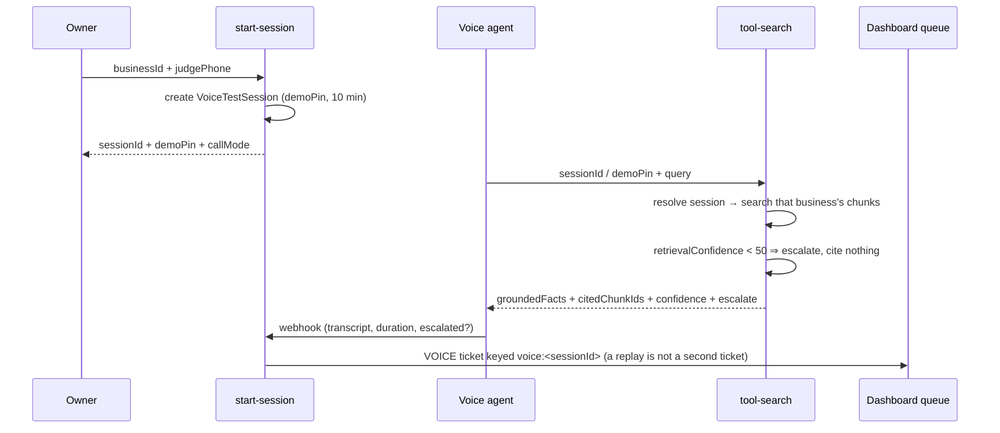

# Architecture — Team 41, PS 2.5 (AfterSales AI)

> Derived from `docs/prd/ps_2_5_master_executable_prd_team_41.md` (rev 4.0) and implemented in
> `src/`. **No implementation claims beyond the "Built today" section.**

## Shape in one paragraph

One inbound path serves every channel: **scoped retrieval → classifier → R1–R7 routing → ticket +
append-only events**. The classifier returns exactly four decision fields plus a draft; the router
decides what happens to it in TypeScript. `businessId` is resolved from the session and checked on
every read, so a tenant boundary is a `WHERE` clause and a `403`, never a prompt instruction. The
owner dashboard reads the same rows the agent writes, so a judge sees the rule, the confidence, the
cited chunk and the reason at the same time.

## Request path

The voice path shares the same retriever and the same coverage floor; it skips the extra model
round-trip so the answer lands inside the caller's turn.

## The decision surface

`confidence_score` and `urgency` are integers 0–100. First match wins.

| Rule | Condition | Outcome | Why it exists |
|---|---|---|---|
| **R1** | `explicit_human_request` | escalate · `failed?` no, `escalated` | The customer asked for a person |
| **R2** | `confidence < 50` **or** no verified chunk | escalate | **The product.** A coin flip is not an answer |
| **R3** | `requires_human_judgment` or `distressed` | escalate | Distress outranks confidence |
| **R4** | `urgency >= 80` | escalate | Money and outages do not wait for a draft |
| **R5** | channel not auto-send | draft | Grounded, but this channel cannot send |
| **R6** | grounded + confident + calm | auto-reply | The repetitive volume, handled |
| **R7** | classifier `null` or runtime error | `failed` | A broken classifier is never a silent reply |

Two invariants are structural, not policy comments:

1. A cited chunk id is verified against **that business's** chunk set before routing. A fabricated or
   cross-tenant citation counts as zero grounding.
2. `escalated` has no automatic exit. Only `PATCH /tickets` with `action=resolve` (a human) closes it.

## Data model

SQLite via Prisma (`prisma/schema.prisma`), five entities plus join-free tenant scoping.

| Entity | Holds | Note |
|---|---|---|
| `User` | owner account (the only authenticated principal) | scrypt password hash, no customer accounts |
| `Business` | facts, `compiledBrainMd`, `brainVersion` | one row per tenant; `ownerId` is the boundary |
| `KnowledgeChunk` | `section`, `content`, `keywords`, `chunkIndex` | derived from the markdown; rebuilt on every save |
| `ChannelConnection` | `channelType`, `status`, `autoSend` | `DRAFT_ONLY` ⇒ R5 |
| `Ticket` | channel, customer ref, state, the four fields, rule, answer, citations | `(businessId, externalMessageId)` **unique per business** = idempotency |
| `TicketEvent` | type + JSON payload | append-only; the drawer renders a summary per type |
| `VoiceTestSession` | `demoPin`, `judgePhone`, status, transcript, expiry | 10-minute TTL, one business per session |

## Tenant and trust boundaries

| Boundary | Treated as | Consequence |
|---|---|---|
| Session cookie | signed HMAC-SHA256, `httpOnly`, 7-day expiry | tamper or expiry ⇒ `null`, never a partial identity |
| `businessId` in a request body | untrusted | `loadOwnedBusiness()` ⇒ `403` for another owner's row |
| Classifier output | untrusted | strict schema validation; invalid ⇒ `null` ⇒ R7 |
| `cited_chunk_ids` from the model | untrusted | filtered against the business's real chunk ids ⇒ R2 if empty |
| Webhook `externalMessageId` | the idempotency key, scoped to the tenant | replay returns this tenant's original ticket with `duplicate: true`; another tenant's id never resolves here |
| Webhook `x-channel-token` | a **platform** credential, not a tenant session | valid ⇒ delivery may write to any business it names (treat the secret like the DB password); unknown `businessId` ⇒ `404`; absent ⇒ owner cookie required. Per-business tokens are deliberately not built |
| Voice `demoPin` / `sessionId` | the capability that scopes a call | expired session ⇒ `410`, wrong tenant ⇒ `403` |
| Voice `citedChunkIds` from the platform | evidence, not authority | kept only when the id is this business's chunk ⇒ R2 escalation otherwise |
| The end customer | always unauthenticated | zero customer credentials exist to leak |

## Voice: one number, per-call context

The voice path holds the **same confidence floor as text** (`retrievalConfidence`, not its own
arithmetic): below 50 it escalates and cites nothing, because a wrong answer is spoken out loud
rather than read. A completion webhook's citations are filtered against that business's chunk ids — no verified
chunk means R2, never an auto-answer — and its ticket is keyed `voice:<sessionId>`, so re-reporting
one call never answers twice. The panel's **Last call** card only ever renders a `completed` or
`failed` session, so an unfinished call cannot be presented as a finished one. The
completed call's transcript, duration and outcome are read back from the database by
`/dashboard?tab=voice`, not from the tab that recorded it.

The shared number is never mutated: the business is a **per-call variable**, resolved from the session
the owner just created. That is what makes AT-04 (same number, two businesses, no bleed) true.

## Hydration across browser extensions

`/auth` reported "a tree hydrated but some attributes of the server rendered HTML didn't match",
naming `bis_skin_checked`, `bis_register` and `__processed_<uuid>__` on elements we render. Those
attributes are Bitdefender's — its web protection writes them into the DOM before React hydrates.
Grammarly, LanguageTool, Dark Reader and ColorZilla do the same under their own names.

The server output was never the problem: two requests for `/auth` are byte-identical apart from
Next's per-request nonce. The mismatch is third-party writes landing between parse and hydration,
and React compares everything React rendered — including Next's own `
` metadata
boundary, which no `suppressHydrationWarning` of ours can reach.

`src/shared/hydration/` holds the fix:

- `extension-attributes.ts` — the marker patterns (`EXTENSION_ATTRIBUTE_PATTERNS`) plus a stripper.
- `guard-install.ts` — `installHydrationGuard`. It **refuses writes** of those attribute names on
  `Element.prototype` (`setAttribute`, `setAttributeNS`, `setAttributeNode`), sweeps the markers an
  extension already wrote, and keeps a `MutationObserver` as a net for write paths the patch does
  not cover. Refusing the write is what makes it deterministic: a MutationObserver strip is a
  microtask, React hydrates synchronously, so cleanup alone can lose the race.
- `src/instrumentation-client.ts` arms it. `instrumentation-client` is the one client entry that
  runs before `hydrateRoot`. Every other home was tried and rejected in a real browser:
  `next/script strategy="beforeInteractive"` defers through `self.__next_s`; a hand-written
  `<head>` shifts Next's head entries; React 19 refuses an inline `<script>` rendered by a
  component; and a `"use client"` module imported by the layout evaluates *after* Next has
  hydrated the outer boundary (the mismatch then lands on Next's own `
`).

`<html>` and `<body>` also carry `suppressHydrationWarning`, which covers markers an extension
puts on those two elements and any extension the guard does not know yet.

`npm run verify:hydration` proves it in headless Chrome: it plays the extension over CDP at
`document_start` and requires (1) an untouched page to hydrate cleanly, (2) an unknown marker to
still produce the mismatch — so the simulation cannot silently stop testing anything — and
(3) the known markers to produce no error and leave nothing behind.

## Built today

| | |
|---|---|
| **Real** | R1–R7 · scoped BM25 · brain compile/chunk/cite · onboarding · queue + drawer + events · human actions · tenant-scoped idempotent webhooks · provider-signed inbound edge · insights · voice session lifecycle + idempotent completion |
| **Conditional** | OpenRouter classifier (needs a key) — otherwise a labelled offline classifier |
| **Simulated, labelled** | WhatsApp/Instagram/Gmail transports; the Sarvam telephone leg |
| **Superseded** | `docs/product/CAPABILITY.md` — the Pipecat/Laya/MCP design this repository started from |

Status lives in the README's *real vs mocked* table. This document is the shape, not the status.
